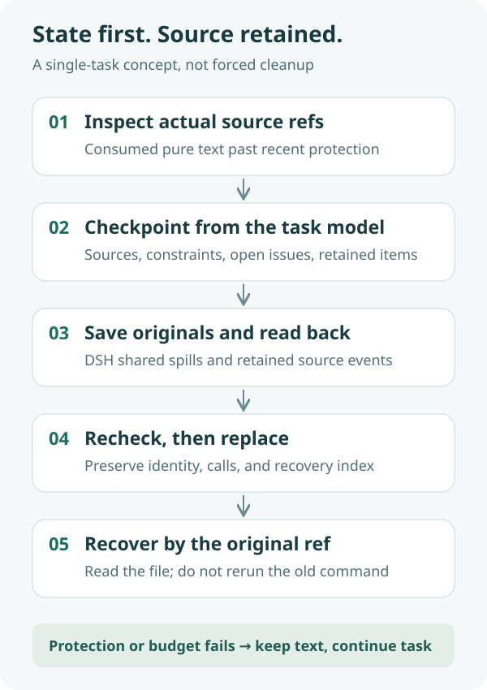

<div align="center">
  
  <h1>dsh-gongjuyasuo</h1>
  <p><strong>Hand off the state. Release tool text. Keep the original recoverable.</strong></p>
  <p>An experimental local Host plugin for individual long-running DeepSeek Harness tasks.</p>
  <p><a href="README.md">简体中文</a> · <strong>English</strong></p>
  <p><a href="package.json">Plugin 0.1.3</a> · Host-only / ESM · No additional summarization model</p>
  <p><a href="#features">Features</a> · <a href="#how-it-works">How it works</a> · <a href="#quick-start">Quick start</a> · <a href="#configuration">Configuration</a> · <a href="#validation-and-limitations">Validation and limitations</a> · <a href="#faq">FAQ</a></p>
</div>

---

Reading code, running tests, and gathering references can accumulate substantial tool output. This plugin asks **the model executing the task to submit a source-linked state checkpoint first**. Pure-text results confirmed no longer directly needed can then be saved to DSH's shared spill store and replaced in the current context with a conclusion and recovery index.

It does not send the entire conversation to another summarizer. There is no additional summarization model, price prediction, task token cap, or watermark-triggered termination. **Observed externalization is not proof of net token savings or absence of performance regression.**

## Features

| Feature | Behavior |
|---|---|
| Traceable handoff | Carries the subgoal, next step, sourced findings, constraints, changes, validation, unresolved issues, and hypotheses |
| Exact provenance | `inspect` advertises real refs; literal evidence and model-written conclusions are linked, not guessed |
| Conservative externalization | Protects recent results, errors, direct dependencies, unresolved sources, inherited messages, mixed content, and existing spills |
| Original recovery | Saves and reads back before replacement; `recover` rebuilds from retained source events rather than rerunning commands |
| Observability | Records success, failure, skips, and character budgets; affected originals stay intact and partial batches are not reported as atomic success |

## How it works



1. **Inspect sources:** call `gongjuyasuo(action="inspect")` at a natural phase boundary or after a reminder.
2. **Hand off state:** submit a `checkpoint` identifying absorbed material no longer directly needed and material that must remain.
3. **Save and verify:** store originals through DSH's shared spill service and verify them by reading back.
4. **Recheck eligibility:** before entering the next model request, recheck protection and budgets, then append prune and content-only replacement events item by item, preserving message identity, calls, and provenance.
5. **Recover when needed:** call `recover` with the original ref, then read the recovered content with an actual file-reading tool.

**Length and age do not prove irrelevance. A valid checkpoint does not guarantee replacement.** If eligibility fails, preserve the original and continue the task rather than lowering handoff quality.

## Quick start

### 1. Prerequisites

- A working DeepSeek Harness Desktop installation providing services such as `spillStore`, `tokenMeter`, `sessionQuery`, and `agents`.
- Verified environment: macOS, Desktop `0.2.1-alpha.4.20261020.1`, Electron `44.7.0` / Node `24.21.0`, and `/usr/local/bin/node`. This identifies a specific local installation build, not a compatibility promise for every similarly named or other version.
- Git for downloading. No additional npm dependencies are required to run the source. Windows, Linux, and other SDK builds have not been verified.

### 2. Download

The destination must not already exist. Preserve your configuration and data rather than overwriting an existing installation.

```sh
DSH_HOME="${DSH_HOME:-$HOME/.dsh}"
git clone https://github.com/yueyexiayu/dsh-gongjuyasuo.git "$DSH_HOME/plugins/dsh-gongjuyasuo"
```

### 3. Configure Desktop loading

**Merge** this entry into the existing `$DSH_HOME/profiles/desktop/cordis.patch.yml`; do not replace other plugin configuration. Paths are relative to that profile patch, not the working directory.

```yaml
- insert:
    - id: dsh-gongjuyasuo
      name: ../../plugins/dsh-gongjuyasuo/lib/index.js
```

The repository's [bundle patch](cordis.patch.yml) uses a package-relative path and cannot be copied verbatim as a profile-relative path. No DSH source changes are needed. Do not use the CLI plugin manager to install dependencies into the Desktop profile.

### 4. Start and verify

Fully quit Desktop (⌘Q on macOS), then reopen it; refreshing the page does not reload the Host. A new task should expose the `gongjuyasuo` tool. Start with `inspect`; no eligible candidates and no replacement is a normal outcome.

In the same authenticated DSH environment, `GET /api/dsh-gongjuyasuo` reports the version, configuration, and runtime state; add `?sessionId=<id>` for session metrics. Do not disable authentication or put login tokens in commands, repositories, or screenshots.

## Configuration

[config.json](config.json) retains the formal defaults. Configuration is read during hooks, tool execution, and the eligibility check after saving.

| Key | Default | Meaning |
|---|---|---|
| `enabled` | `true` | Disables new reminders, checkpoints, and externalization when false; existing refs remain recoverable |
| `thresholdChars` | `1500` | Per-result character threshold, not proof of irrelevance |
| `excludeTools` | `[]` | Tool names excluded from processing |
| `summaryTemplate` | See config | Must contain `{{checkpoint}}` and `{{index}}` |
| `watermarkChars` | `24000` | Candidate-character reminder threshold, not forced cleanup or task termination |
| `recentProtectionRequests` | `2` | Protects for two additional successful requests after first confirmed successful consumption |
| `reminderIntervalRequests` | `6` | Reminder interval; unchanged candidates without actual progress are also deduplicated |
| `minNetReductionChars` | `4000` | Estimated net character threshold after handoff and receipt costs, not provider token savings |
| `minTailContributionChars` | `1000` | Skips low-contribution items at the front of the window |

<details>
<summary><strong>Checkpoint format and protection</strong></summary>

`checkpoint` requires `state`, nonempty `covered`, and `retain` (use `[]` when nothing is retained). Explicit `previousCheckpoint:null` is recommended for the first checkpoint. `resolvedIssues` may be omitted or `[]`, but that never permits dropping previous unresolved issues. Inherited constraints must remain; unresolved issues must be carried unchanged or explicitly resolved with supported evidence.

`state` contains `subgoal`, `nextStep`, `findings`, `constraints`, `changes`, `validation`, `unresolved`, and `hypotheses`. Each covered item needs a real ref, a conclusion, a literal quote of at least 16 characters, and `noLongerDirectlyNeeded:true`. Direct dependencies and sources of unresolved errors must be retained.

Only pure-text results with a known call, confirmed successful consumption, expired recent protection, and current content identical to the original append qualify. NUL text, errors, mixed content, existing spills, upstream replacements, inherited sources, and invalid handoffs remain intact. Prepare and commit share one formula and deduct a 400-character receipt reserve; insufficient budgets are rejected explicitly without lowering the threshold.

</details>

<details>
<summary><strong>Local data and privacy</strong></summary>

Configuration defaults to the package's `config.json`. Diagnostics default to `$DSH_HOME/storages/dsh-gongjuyasuo/diagnostics.jsonl`. Original storage and recovery depend on DSH's shared spill service and retained session source events, not an independent cloud backup.

Originals, sessions, diagnostics, and recovery locations may contain task content or private information. Do not upload them. A strict repository allowlist includes only source, tests, a sanitized fixture, and documentation; local raw evaluations, sessions, SDK copies, dependencies, and caches are excluded.

The plugin adds no model requests or upload service of its own, but changes the context received by the executing model. It does not change the data practices of DSH's existing model providers.

</details>

## Validation and limitations

- Plugin 0.1.3 has **51 zero-model mechanism tests** in the installation environment above, covering the actual installed kernel, projections, tool protocol, shared I/O, recovery, cancellation, failure protection, and consistent budgeting. This is not a live CI badge or a savings sample.
- A historical controlled task observed three replacements and continued business execution. Its original automatic evaluation remained failed because of a readback path-alias assertion; subsequent offline file-identity and original-byte checks passed without rewriting that failure. A later five-case pilot also retained all original failed statuses; successful read-only source replay does not promote them to frozen-protocol passes.
- Raw evaluations and private sessions are not included. The separate local Stage 2 benchmark 0.1.1 and its 118 tests are neither the plugin version nor this public mechanism suite, and are not combined with its results.
- There is no established net token saving, no-performance-regression, statistical-significance, or complete development-usage conclusion. Character reduction is not provider billing savings. Full coverage of hidden backend requests/retries has not been independently proven.
- Externalization happens only when protection and net-reduction conditions hold; large checkpoints also consume context. DSH manages its own official basic compaction; this plugin does not replace it.

From the repository root, these local checks do not start benchmark model tasks:

```sh
npm run build
npm test
```

Tests depend on the macOS installation paths and installed SDK above; they are not standalone tests for arbitrary Node environments. The `--run` / `--repair-run` modes of `scripts/smoke.mjs` request a model and are not part of these checks or free tests to run automatically. `scripts/verify-repair-evidence.mjs` requires unpublished raw evidence; downloading this public repository does not supply those inputs.

## FAQ

**Why is there a reminder but no replacement?** A reminder does not force cleanup. Inspect, then submit a complete handoff. Recent protection, direct dependencies, unresolved sources, or insufficient net reduction preserve originals. Having no valid candidate is not itself an error.

**How do I update?** Preserve configuration and local data, inspect Git status, merge updates, and fully restart Desktop. Do not reset local changes or overwrite the profile with the package patch.

**How do I disable or uninstall it?** Prefer `enabled:false` so recovery stays available. Removing the loader entry also removes the recovery tool. Recover what you need and retain sessions/spills before removing the profile entry and fully restarting. Deleting the code directory is not a data migration strategy.

**Does it call another summarization model?** No. The executing model writes the handoff, with no additional summarizer. Handoff and recovery still have context costs; they are not guaranteed free or token-saving.

## Community and license

This is a third-party experimental DSH plugin, not an official built-in feature or a claim of official review or listing. The public repository supports source viewing and issue discussion. **No open-source license has been selected:** public visibility does not grant an MIT-style license to use, modify, or redistribute. DSH and its third-party dependencies are not distributed here and remain subject to their respective terms.

<div align="center"><sub>Keep the state, and keep a path back to the source. · <a href="README.md">阅读中文版 →</a></sub></div>
