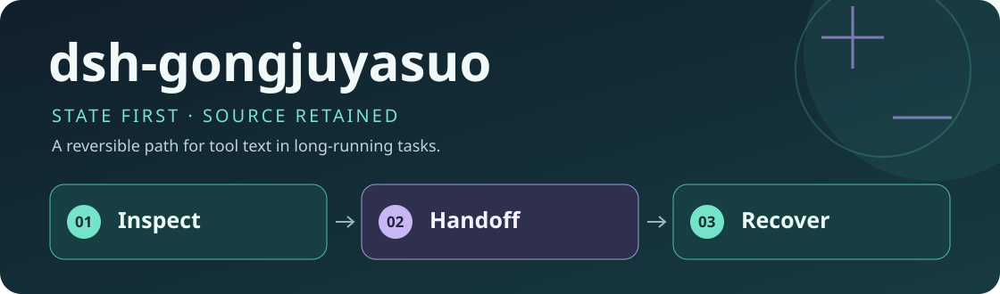
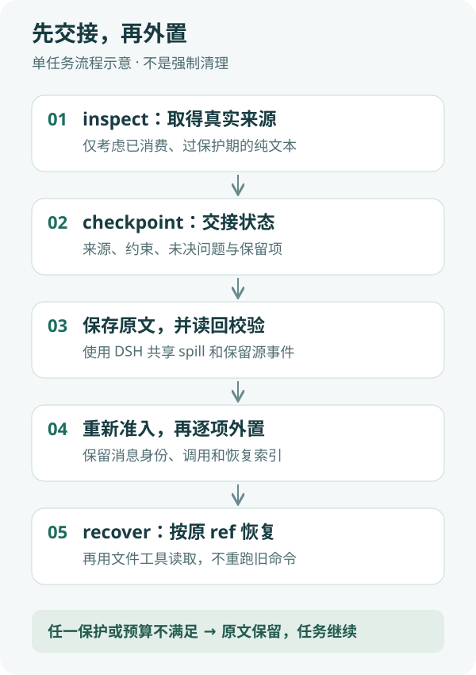

<div align="center">
  
  <h1>dsh-gongjuyasuo</h1>
  <p><strong>先交接状态，再释放工具正文；需要时找回原文。</strong></p>
  <p>面向单个长任务的实验性 DeepSeek Harness 本地 Host 插件。</p>
  <p><strong>简体中文</strong> · <a href="README.en.md">English</a></p>
  <p><a href="package.json">插件 0.1.4</a> · 纯 Host / ESM · 无额外总结模型</p>
  <p><a href="#核心能力">核心能力</a> · <a href="#工作方式">工作方式</a> · <a href="#快速开始">快速开始</a> · <a href="#配置">配置</a> · <a href="#验证与限制">验证与限制</a> · <a href="#常见问题">常见问题</a></p>
</div>

---

长任务中，读代码、运行测试和查询资料会留下大量工具正文。这个插件让**执行任务的模型先提交可追溯的状态检查点**，再将确认不再直接依赖的纯文本结果保存到 DSH 共享 spill，并在当前上下文中换成结论与恢复索引。

不是把整个对话交给另一个模型压缩：没有额外总结模型、价格预测、任务 token 硬上限或水位强制终止。**已经发生外置，不等于已经证明实际 token 净节省或性能不退化。**

## 核心能力

| 能力 | 具体行为 |
|---|---|
| 可追溯交接 | 记录当前子目标、下一步、发现及来源、约束、修改验证、未决问题和假设 |
| 精确来源 | `inspect` 提供真实 ref；逐字引文与模型声明结论绑定，不猜引用 |
| 保守外置 | 保护近期、错误、直接依赖、未决来源、继承消息、混合内容和已有 spill |
| 原文恢复 | 保存并读回校验后才替换；`recover` 从保留源事件重建，不重跑旧命令 |
| 可观测 | 记录成功、失败、跳过和字符预算；受影响原文保留，不伪装原子批次成功 |

## 工作方式



1. **检查来源**：在自然阶段结束或收到提醒时，调用 `gongjuyasuo(action="inspect")`。
2. **交接状态**：模型提交 `checkpoint`，明确哪些已吸收且不再直接依赖，哪些必须保留。
3. **保存并核验**：原文通过 DSH 共享 spill 保存并读回验证。
4. **重新准入**：下一次进入模型请求前重新检查保护与预算，逐项追加 prune 和 content-only replace，保留消息身份、调用与来源。
5. **需要就恢复**：使用原 ref 调用 `recover`，再通过实际文件读取工具读取恢复内容。

**长度和年龄不是“无用”的证明；有效检查点也不保证一定能外置。** 不满足条件就保留原文并继续任务，不为清理而降低交接质量。

## 快速开始

### 1. 前置条件

- 已安装并可运行 DeepSeek Harness Desktop，具备插件使用的 `spillStore`、`tokenMeter`、`sessionQuery`、`agents` 等服务。
- 已验证环境：macOS、Desktop `0.2.1-alpha.4.20261020.1`、Electron `44.7.0` / Node `24.21.0`，以及 `/usr/local/bin/node`。这是具体本机安装构建，不是所有同名/其他版本的兼容承诺。
- Git 用于下载；运行源码不需要安装新的 npm 依赖。Windows、Linux及其他 SDK 构建尚未验证。

### 2. 下载插件

目标目录应尚不存在；已有安装不要覆盖，先保留自己的配置和数据。

```sh
DSH_HOME="${DSH_HOME:-$HOME/.dsh}"
git clone https://github.com/yueyexiayu/dsh-gongjuyasuo.git "$DSH_HOME/plugins/dsh-gongjuyasuo"
```

### 3. 配置 Desktop 加载

将下面一项**合并**到现有 `$DSH_HOME/profiles/desktop/cordis.patch.yml`，不要覆盖其他插件配置。路径相对于这份 profile patch 文件，而非当前工作目录。

```yaml
- insert:
    - id: dsh-gongjuyasuo
      name: ../../plugins/dsh-gongjuyasuo/lib/index.js
```

仓库内的 [bundle patch](cordis.patch.yml) 是包内相对路径，不能直接当作 profile 相对路径使用。无需改 DSH 官方源码，也不要用 CLI 插件管理器向 Desktop profile 安装依赖。

### 4. 启动与确认

完整退出 Desktop（macOS：⌘Q）后重新打开；单纯刷新页面不足以重载 Host。新任务中应能看到 `gongjuyasuo` 工具，可先执行 `inspect`；没有候选时不发生外置是正常结果。

在已认证的同一 DSH 环境中访问 `GET /api/dsh-gongjuyasuo` 可查看版本、配置及运行状态，附 `?sessionId=<id>` 可查会话指标。不要关闭认证或把登录 token 写进命令、仓库或截图。

## 配置

[config.json](config.json) 保留正式默认值。配置会在钩子、工具执行及保存后的重新准入时读取。

| 键 | 默认值 | 含义 |
|---|---|---|
| `enabled` | `true` | 关闭后停止新提醒、检查点和外置；已有 ref 仍可恢复 |
| `thresholdChars` | `1500` | 单结果字符门槛，不等于无用证明 |
| `excludeTools` | `[]` | 不参与处理的工具名 |
| `summaryTemplate` | 见配置 | 必须包含 `{{checkpoint}}` 与 `{{index}}` |
| `watermarkChars` | `24000` | 候选字符提醒水位，不强制清理或停止任务 |
| `recentProtectionRequests` | `2` | 首次明确成功消费后，再保护两个成功请求 |
| `reminderIntervalRequests` | `6` | 提醒间隔；无实际进展的同候选还会去重 |
| `minNetReductionChars` | `4000` | 扣交接与收据后的估计净字符门槛，不是 provider token 收益 |
| `minTailContributionChars` | `1000` | 跳过最前端低贡献项 |

<details>
<summary><strong>检查点格式与保护条件</strong></summary>

`checkpoint` 必须有 `state`、非空 `covered`、`retain`（没有保留项也传 `[]`）；首次建议显式传 `previousCheckpoint:null`。`resolvedIssues` 可省略或为 `[]`，但不能因此丢失旧未决项。继承约束必须保留，未决项必须原样承接或用有来源的明确解决记录关闭。

`state` 包含 `subgoal`、`nextStep`、`findings`、`constraints`、`changes`、`validation`、`unresolved` 和 `hypotheses`。每个 covered 项需要真实 ref、结论、至少16字符逐字依据和 `noLongerDirectlyNeeded:true`。直接依赖或未解决错误的来源必须 retain。

只处理可定位调用、已明确成功消费、过近期保护期且当前正文仍与原 append 一致的纯文本。NUL、错误、混合内容、已有 spill、上游替换、继承源及无效交接保留。prepare/commit 使用同一公式，另扣400字符收据预留；不足时明确拒绝，不降低门槛。

</details>

<details>
<summary><strong>本地数据与隐私</strong></summary>

配置默认从包内 `config.json` 读取；诊断默认写入 `$DSH_HOME/storages/dsh-gongjuyasuo/diagnostics.jsonl`。原文保存和恢复依赖 DSH 共享 spill 与保留的会话源事件，不是独立云端备份。

原文、会话、诊断和恢复位置可能包含任务内容或私人信息。不要上传这些数据。公开仓库通过严格 allowlist 仅跟踪源码、测试、脱敏夹具和说明；本机原始评测、会话、SDK副本、依赖和缓存不公开。

插件不添加自己的模型请求或上传服务，但会修改执行模型后续收到的上下文；DSH 原有模型提供方的数据行为不因此改变。

</details>

## 验证与限制

- 插件0.1.3在上述安装环境有 **51项零模型机制测试**，覆盖实际安装内核、投影、工具协议、共享 I/O、恢复、取消、失败保护和预算一致性；不是实时 CI 徽章，也不是收益样本。
- 历史受控任务观察过3次外置与后续业务执行；原自动验收因回读路径别名断言而 failed，该失败没有改写，离线文件身份/原文字节核对随后通过。后续5例原结果也全部 failed，来源只读回放通过不升级为原协议通过。
- 原始评测/私人会话不在公开仓库中。独立本地阶段2基准0.1.1及其118项测试不是插件版本或公开机制套件，不在这里混报。
- 没有已证明的 token 净节省、性能不退化、统计显著性或完整开发用量结论；字符缩减不能当作 provider 计费节省。后端隐藏请求/重试的完整账单覆盖没有独立证明。
- 只在保护和净缩减条件满足时外置；大型检查点自身也会占上下文。官方基础压缩仍由 DSH 自己管理，本插件不替代它。

在仓库根目录运行以下本地验证，不会发起基准模型任务：

```sh
npm run build
npm test
```

测试依赖上面的 macOS 安装路径与安装版 SDK，并不是任意 Node 环境里的独立单测。`scripts/smoke.mjs` 的 `--run` / `--repair-run` 会请求模型，不属于上述验证，不能当作免费单测自动运行；`scripts/verify-repair-evidence.mjs` 需要未公开的原始证据，公开下载本身不满足其输入。

## 常见问题

**为什么收到提醒，却没有折叠？** 提醒不是命令强制清理。先 inspect，再提交完整交接；近期保护、仍直接依赖、未决来源和净缩减不足都会使原文保留。没有有效候选也不是错误。

**如何更新？** 先保留配置和本地数据，检查 Git 状态，合并更新后完整重启 Desktop。不要用 reset 覆盖本地改动或复制包内 patch 覆盖 profile。

**如何暂时关闭或卸载？** 优先设 `enabled:false`，保留恢复工具。彻底移除加载项会同时移除恢复工具；先完成所需恢复并保留会话/spill，再从 profile 删除该插件项、完整重启。只删代码目录不是数据迁移方案。

**会不会再调用一个模型总结？** 不会。状态交接由当前执行模型完成，没有额外总结模型；但交接与恢复也有上下文成本，不承诺免费或必然省 token。

## 社区与许可

这是第三方实验性 DSH 插件，不是官方内置功能，也未宣称通过官方审核收录。仓库公开用于源码查看与问题讨论；**目前尚未设置开放源码许可证**，公开可见不等于授予 MIT 等使用、修改或再分发许可。DSH 与其第三方依赖不随本仓库分发，各自条款另行适用。

<div align="center"><sub>保留关键状态，也保留原文出口。 · <a href="README.en.md">Read in English →</a></sub></div>
